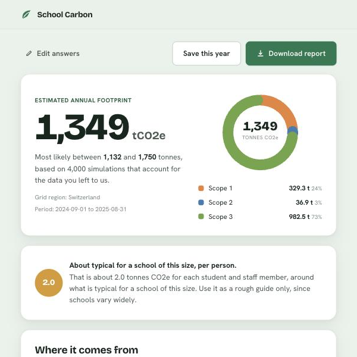

# School Carbon Tool


> [!NOTE]
> A self-contained, browser-only carbon footprint estimator for schools. There is no server and no account: open `index.html`, or put the folder on any static host.

A school fills in a short form (a utility bill, headcount and a rough building size are enough) and gets **one headline number** for its annual footprint, with an uncertainty range and a step-by-step derivation showing where every figure came from. Anything the school doesn't know is **estimated from published proxies and labelled as an estimate**, so a measured figure and a guess are never presented as equally certain.

### Contents
[Screenshot](#screenshot) · [What it covers](#what-it-covers) · [Worked example](#worked-example) · [How the estimate is built](#how-the-estimate-is-built) · [Running it](#running-it) · [Files](#files) · [Privacy](#privacy) · [Limits](#limits) · [License](#license)

## Screenshot

**Example data, not a real school.** The top of the report the tool produces for the worked example below: the headline figure, the likely range from 4,000 simulations, and the split across Scopes 1, 2 and 3.



## What it covers

Scopes follow the GHG Protocol's categories.

| Category | Scope | Needs from the school (optional unless noted) |
|---|---|---|
| Purchased electricity | 2 | kWh, or spend and unit price |
| Heating & on-site fuel | 1 | fuel type and amount; otherwise estimated from floor area and climate |
| School-owned vehicles | 1 | litres of fuel |
| Staff & student commuting | 3 | average commute distance |
| Air travel | 3 | passenger-km |
| Food & catering | 3 | meals per day and diet mix |
| Water supply & treatment | 3 | m³ |
| Waste disposal | 3 | tonnes and recycling rate |
| Goods & services (procurement) | 3 | spend |

Only the **country, student and staff numbers** are required. The factor library has grid factors for **54 countries** plus regional and world fallbacks; areas and volumes accept metric or imperial units; boarding and day pupils are handled separately.

## Worked example

A 690-person Swiss mixed school (600 students, 90 staff, 100 boarders), 12,000 m², 190 school days, **900,000 kWh** of electricity, everything else left blank:

| Category | tCO₂e | Basis |
|---|---|---|
| Food & catering | 421.0 | estimated (weak) |
| Heating | 329.3 | estimated from floor area (strong) |
| Procurement | 310.5 | estimated (weak) |
| Commuting | 237.9 | estimated (weak) |
| Electricity | **36.9** | measured: 900,000 kWh × 0.041 kg/kWh |
| Waste | 11.2 | estimated (weak) |
| Water | 1.9 | estimated (weak) |
| **Total** | **1,348.7** | P10–P90 range 1,121–1,751 |

The categories add up exactly to the total, and the Monte-Carlo range is repeatable because it is seeded. Reproduce all of this with:

```bash
node tests/example.js
```

It runs the real engine on that school and checks six things: the electricity and heating figures, that categories and scopes both sum to the total, the seeded range, and that P10 < P50 < P90.

## How the estimate is built

- **Measured vs estimated.** Each category carries a confidence tier (measured, estimated-strong, estimated-weak). Missing data is filled from published proxies (CIBSE building benchmarks; national commuting, diet, water and waste averages) and labelled as such.
- **Uncertainty.** A Monte-Carlo run of **4,000** draws gives a P10–P90 range. Measured data is tight (±7%); school-specific estimates are wider (±25%); country or global defaults are widest (±45%).
- **Sourced factors.** Every emission factor in `assets/factors.js` carries its value, unit, source name, year and a link to the primary source (Ember, IEA, UK DEFRA/DESNZ, GHG Protocol, CIBSE, Poore & Nemecek 2018). The factor-set version (`2024.1`) is stamped on each report so past reports are never silently recalculated with newer factors.
- **Derivation.** The report lists the step-by-step working for every figure, with its source.
- **Trend.** A year-over-year comparison appears once a school has saved a previous year.
- **PDF.** "Download report" produces a PDF with clickable source links (jsPDF, bundled in `assets/vendor/`).

## Running it

<details>
<summary><b>Run locally or host it</b> (click to expand)</summary>

It is a static site with no build step. From this folder:

```bash
python3 -m http.server 8123
# then open http://localhost:8123
```

Opening `index.html` directly also works in most browsers. To publish it, upload the folder to any static host (GitHub Pages, Netlify, S3, a school website).

To run the example check you need Node.js: `node tests/example.js`.

</details>

## Files

| File | Role |
|---|---|
| `index.html` | Page shell and script loading |
| `assets/styles.css` | All styling; responsive |
| `assets/factors.js` | Emission-factor library: every value with its source, year and URL |
| `assets/engine.js` | Pure calculation: unit conversion, imputation, Monte-Carlo, derivation trace (deterministic given a seed) |
| `assets/report.js` | Renders the number, derivation, confidence, trend and disclaimer |
| `assets/app.js` | Multi-step form, resumable draft, input normalisation, wiring |
| `assets/map.js` | Optional map for measuring building area |
| `assets/download.js` | PDF report |
| `assets/fonts/`, `assets/vendor/` | Self-hosted fonts and the jsPDF library |
| `tests/example.js` | Runs the worked example against the real engine |

## Privacy

There is no backend and no analytics. The answers a school enters are processed in the browser; a draft and saved years are kept in that browser's `localStorage` only. Fonts and the PDF library are served from the same folder.

The **optional map** (opened only by clicking the map button) does contact other services:

| Service | Used for | What it receives |
|---|---|---|
| `cdn.jsdelivr.net` | Loads the map libraries (Leaflet, Leaflet-Geoman, Turf) | A normal page request (your IP address) |
| `server.arcgisonline.com` | Satellite map tiles | Tile requests for the area you view |
| `ipwho.is`, then `ipapi.co` | Places the pin near your approximate location | Your IP address |
| `nominatim.openstreetmap.org` | Address search | The text you search for |

## Limits

- **It is a screening estimate, not a verified or certified footprint.** The on-screen report and the PDF both say so, and note that it does not satisfy any mandatory reporting requirement. Figures built from defaults are labelled "estimated".
- **Emission factors are a curated snapshot** (factor set `2024.1`) and should be refreshed from the live datasets each year. There is no automated check that every source link is still live.
- **History and drafts live in one browser on one device.** Moving them across devices needs a database in place of `localStorage`; the storage code is isolated in `app.js` (`STORAGE_SEAM`) for that purpose.
- **The interface is English only**; strings are inline.

## License

[MIT](LICENSE) © 2026 Anvith Yalamanchili
